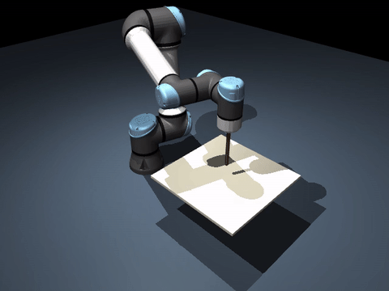
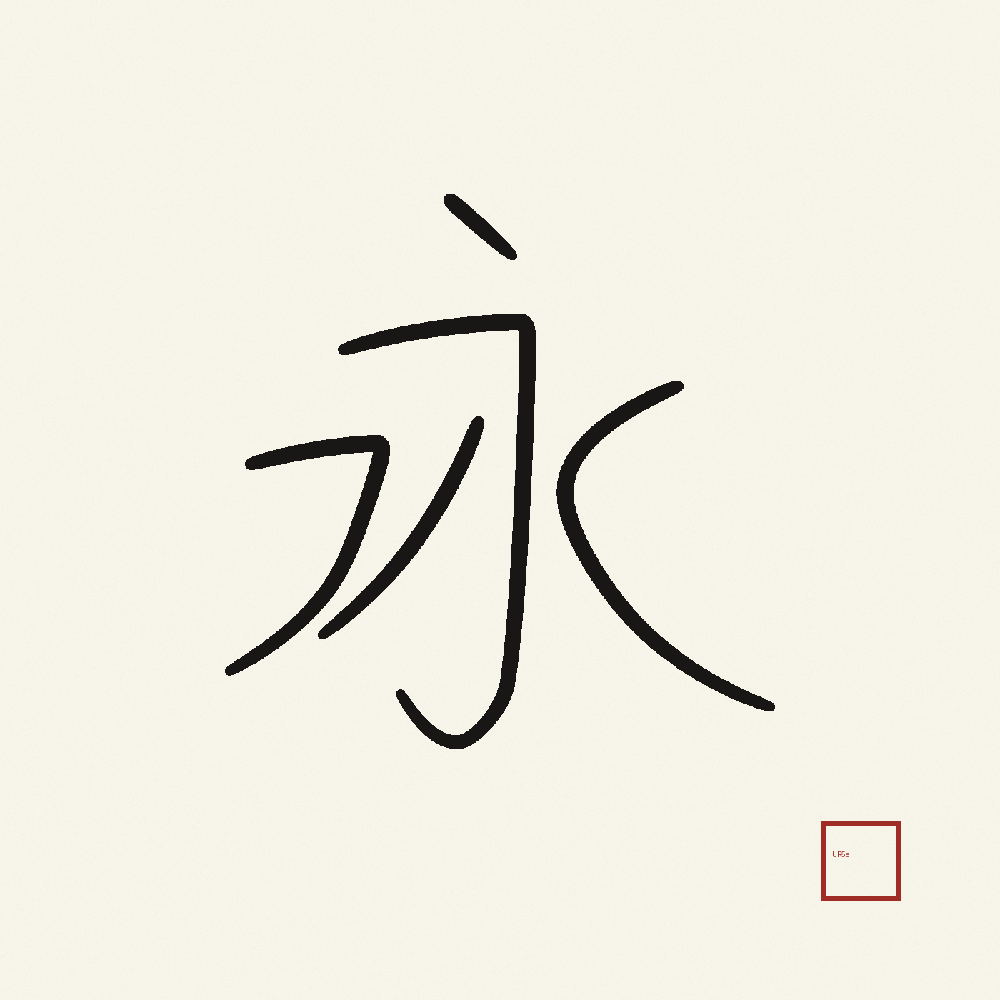

# UR5e 机械臂书写仿真

基于 Python 与 MuJoCo，实现 UR5e 六轴机械臂在纸面书写示例“永”字，完成分笔画运动、抬落笔、轨迹跟踪及笔迹可视化。

## 演示效果

[](results_v2/demo.mp4)



## 技术路线

采用 MuJoCo Menagerie 的 UR5e 模型，将毛笔近似为刚性笔杆，将二维笔画路径映射到纸面坐标。

对各笔画进行曲线插值与时间规划，通过抬笔、移笔和落笔动作连接笔画，保持书写过程中末端姿态固定。

通过逆运动学生成关节目标，执行关节位置控制，记录实际笔尖轨迹并生成笔迹，分析轨迹跟踪误差。

## 核心算法

**轨迹规划：** 分段三次保形插值（PCHIP）、近似弧长重采样及五次多项式时间缩放，实现连续运笔与平滑起停。

**逆运动学：** 初始姿态采用有边界的多初值最小二乘求解；后续采用雅可比阻尼最小二乘法，以前一时刻的关节解作为初值。

**执行控制：** 使用模型位置执行器与重力补偿，通过 MuJoCo 动力学仿真跟踪关节目标。

**笔迹生成：** 根据实际笔尖位置绘制笔迹，以无量纲“虚拟提按”调整笔宽，支持常规、浓笔和细笔风格。

## 仿真结果

默认配置下，单次运行共执行 5,141 个目标点，位置逆解达标率为 100%（误差小于 1 mm）。书写阶段三维轨迹跟踪 RMSE 为 **1.80 mm**，最大误差为 **2.84 mm**，全部书写采样点的跟踪误差小于 3 mm。

上述指标为仿真轨迹跟踪结果，不代表实机定位精度。当前字形为原创示例路径，并非王羲之真迹复刻；笔迹采用几何近似，尚未模拟软毛变形、真实接触力和墨水扩散。

## 运行

```bash
uv sync --locked
uv run main.py
```
